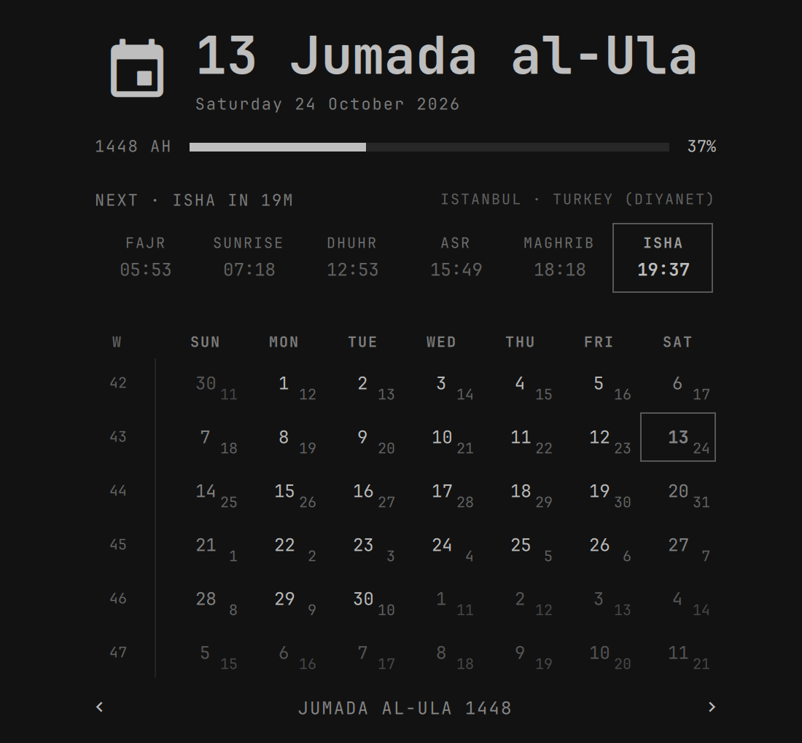
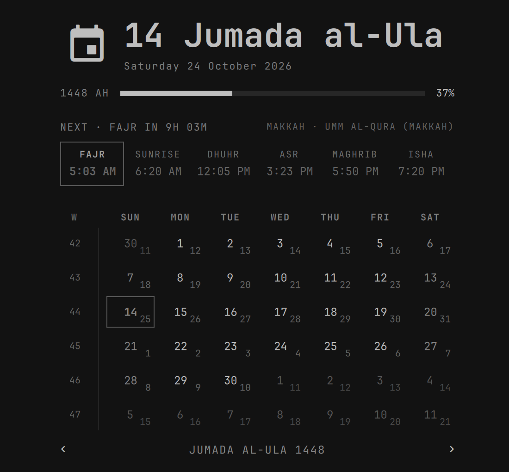

# Hijri Clock

An [Omarchy](https://omarchy.org) bar clock with an Umm al-Qura **Hijri calendar**, **prayer times** (salah / namaz) for the five daily prayers, and quiet reminders. Prayer times are calculated offline, so there is no network, no location service and no account.

<p align="center"></p>

## Features

- **Hijri calendar popup** (Umm al-Qura, 1400-1500 AH) with Gregorian days, ISO week numbers and year progress.
- **Prayer times** for Fajr, Sunrise, Dhuhr, Asr, Maghrib and Isha, with the next prayer outlined and a countdown.
- **Regional setup**: 90 cities that pick their country's authority automatically, custom coordinates, 19 calculation methods, Standard or Hanafi Asr, a high-latitude rule, per-prayer minute offsets, 12/24-hour time and a configurable week start.
- **Hijri date at Maghrib**: optionally move the Hijri date forward at sunset, as the Islamic day does.
- **Quiet reminders**: a low-priority notification before each prayer, gone in 8 seconds, no sound.
- **Bar label placeholders**: `{hd} {hMMMM} {hy}` for the Hijri date and `{np} {nt} {nr}` for the next prayer, its time and the time left.

<p align="center">
  
</p>
<p align="center">
  <br>
  
</p>

The second screenshot is Makkah with the Umm al-Qura method, 12-hour time and "Hijri day changes at Maghrib": it is after Maghrib, so the date already reads 14 Jumada al-Ula.

## Install

```bash
omarchy plugin add https://github.com/lAvArt/hijri-clock
omarchy bar move io.github.lavart.hijri-clock --section center   # or add it in the bar settings
```

To replace the stock clock, switch the layout entry `omarchy.clock` to `io.github.lavart.hijri-clock` in `~/.config/omarchy/shell.json`.

## Remove

Remove the widget from the bar (or restore `omarchy.clock`), then `omarchy plugin remove io.github.lavart.hijri-clock`.

## Prayer times setup

Everything is in the widget's settings (or its entry in `shell.json`). Prayer times are off until you set `prayerTimes` to `On`.

| Setting | Meaning |
| --- | --- |
| `prayerCity` | A city from the built-in list of about 90 (Istanbul, London, Jakarta, Toronto, Makkah, ...). Empty uses the city matching your system time zone. Picking a city also picks its country's calculation method. |
| `prayerLatitude`, `prayerLongitude` | For a place not in the list. `41.0082`, `41,0082` and `33.87 S` all work. Overrides the city. |
| `prayerMethod` | `Auto (by region)` or one of 19 methods: Muslim World League, ISNA, Egyptian, Umm al-Qura, Karachi, Tehran, Jafari, Gulf, Kuwait, Qatar, Dubai, Singapore/Malaysia/Indonesia, Turkey (Diyanet), France (UOIF), Russia, Jordan, Tunisia, Algeria, Morocco. |
| `prayerAsr` | Standard (Shafi'i, Maliki, Hanbali) or Hanafi. |
| `prayerHighLatitude` | Fajr/Isha rule where the sun does not get low enough: Auto, None, Middle of the night, One-seventh, Angle-based. |
| `prayerOffsetFajr` ... `prayerOffsetIsha` | Per-prayer minute adjustments, -60 to 60, on top of the method. |
| `prayerTimeFormat` | System (follows your locale), 24-hour or 12-hour. |
| `hijriDayChange` | `At midnight` or `At Maghrib` (the Hijri date moves on at sunset). |
| `weekStartDay` | Locale default, Saturday, Sunday or Monday. |
| `prayerNotify`, `prayerReminderMinutes` | A quiet reminder for each of the five prayers, `prayerReminderMinutes` before it (default 10; 0 = at the prayer). Low urgency, 8 seconds on screen, no sound, and each replaces the last instead of stacking. Sent with `omarchy-notification-send`. Off by default. |

Bar label placeholders when prayer times are on: `{np}` next prayer, `{nt}` its time, `{nr}` time remaining, e.g. `HH:mm  ·  {np} 'in' {nr}`. Right-click offers two presets.

`qs ipc`-style call for scripts: `omarchy-shell io.github.lavart.hijri-clock nextPrayer` prints e.g. `Isha 19:37 (20m)`.

### Accuracy and limits

- Times are shown in your system time zone, so they are right when the chosen place is where you are. Daylight saving is handled by the system.
- The calculator was checked against the public Aladhan API for 20 method/place/date combinations: within a minute, apart from rounding. Turkey, Dubai, Jordan and Morocco include the extra minutes their authorities publish.
- Umm al-Qura keeps Isha 120 minutes after Maghrib during Ramadan.
- The Moonsighting Committee method is not included. Hijri dates follow the Umm al-Qura table (1400-1500 AH), which can differ by a day from local moon sighting.
- Prayer times are a convenience, not a religious ruling. Confirm with your local authority.

## Dependencies and license

No external dependencies beyond Omarchy (Quickshell, `timedatectl` for the time-zone default, `omarchy-notification-send` for notifications). MIT, see [LICENSE](LICENSE). Derived from Omarchy's `omarchy.clock`, see [NOTICE.md](NOTICE.md).

## Tests

```bash
node test/prayer-test.js
```
